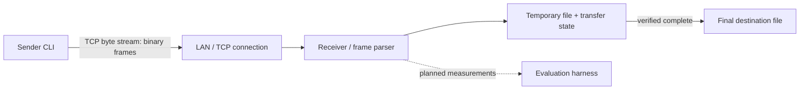

# Proposed architecture and data flow

**Status:** conceptual architecture. The wire format and message/state behavior have a review draft in [protocol-specification.md](protocol-specification.md); component boundaries and storage details remain provisional.

## Components

- **Sender CLI:** accepts a source path and receiver address; obtains file metadata; streams bytes.
- **Receiver/listener:** accepts a TCP connection, parses frames, validates transfer state, writes to a temporary destination, and finalizes only after verification.
- **Protocol codec:** encodes/decodes binary frames and rejects invalid lengths, types, or versions before processing payloads.
- **Transfer state store:** minimal metadata needed to identify a partial transfer and resume it. Persistence format and retention policy are open questions.
- **Evaluation harness (later):** creates repeatable file inputs and records timings, bytes sent, memory observations, and outcomes. No harness exists yet.

## High-level topology



## Proposed initial transfer sequence

```mermaid
sequenceDiagram
    participant S as Sender
    participant R as Receiver
    participant D as Receiver disk
    S->>R: OFFER (name, size, SHA-256; version in frame header)
    R->>D: create or locate partial transfer state
    R-->>S: READY (next expected offset)
    loop one bounded chunk at a time
        S->>R: DATA (transfer id, offset, bytes)
        R->>D: write chunk
        R-->>S: ACK (after write + sync)
    end
    S->>R: FINISH
    R->>D: verify length and SHA-256; rename staged file
    R-->>S: COMPLETE (verified digest) or ERROR
```

This sequence reflects the current review draft; see the specification for field widths, limits, transition rules, and remaining open choices. TCP preserves byte order within a connection, but a parser still needs explicit message framing.

## Conceptual frame layout

The draft wire format is:

`magic | protocol_version | message_type | flags | payload_length | transfer_id | payload`

The proposed header is fixed at 28 bytes, uses big-endian integers, and has a strict payload maximum. See the specification for exact validation behavior.

## State outline

Sender: `Preparing → Offering → Sending ↔ Interrupted → Finishing → Complete`.

Receiver: `AwaitOffer → Receiving → Verifying → Committing → Complete`, with connection loss entering `Interrupted` and terminal errors entering `Failed`.

Detailed transitions, duplicate/reconnect behavior, and durable checkpoint assumptions are in the protocol specification. Timeout values, cleanup policy, and destination collision behavior remain open.
