# LAN File Transfer Protocol (LFTP) — prototype specification

**Status: review draft with a local prototype in progress.** This document defines the smallest protocol for framed control/data messages over TCP, bounded streaming, whole-file integrity verification, and resume after a connection is lost. Values marked **Tentative** are working defaults, not measured or validated choices. The code currently implements the choices marked **Prototype choice**. No benchmark or experimental result is claimed.

## 1. Purpose and limits

The protocol transfers one file from one sender to one receiver over a TCP connection on a trusted LAN. It makes message boundaries, file identity, progress, completion, and failure behavior explicit. TCP supplies ordered bytes while a connection is alive; this protocol supplies file-level meaning and the information needed to continue on a later connection.

This is an educational prototype, not a production file-transfer service. It does not provide peer authentication, encryption, hostile-network protection, discovery, multiple-file batches, or delta/block synchronization. A SHA-256 digest detects a mismatch with the sender's expected file; it does not prove who sent the file or stop an active attacker from changing both data and digest. Do not expose an unauthenticated receiver outside a trusted test network.

## 2. Prototype decisions

| Concern | Working choice | Status and reason |
|---|---|---|
| Transport / scope | TCP; one sender, one receiver, one file | **Tentative**, consistent with the project scope. TCP is a byte stream, not a message protocol. |
| Negotiation | No separate handshake; protocol version appears in every frame | **Tentative**, avoids capabilities that the first prototype does not need. |
| Frame header | Fixed 28-byte header, network byte order (big-endian) | **Tentative**, simple to parse and review. |
| Maximum frame payload | 1 MiB | **Tentative** safety limit. A declared length is checked before allocating or reading that payload. |
| Data chunk | 256 KiB of file bytes | **Tentative** default below the frame cap; tune only in later measurements. |
| Transfer ID | Sender-created random 128-bit ID, reused on reconnect | **Tentative**, separates a transfer from a TCP connection and from its filename. |
| Resume model | Contiguous prefix; receiver reports the next expected byte offset | **Tentative**, no per-chunk map is needed because data is written in order. |
| Acknowledgment | One ACK after each DATA chunk has been written and synced | **Tentative** correctness-first rule; may reduce throughput and can be revised after a working baseline. |
| Integrity | SHA-256 of the complete source file, declared in OFFER and checked after all bytes arrive | **Tentative**; the receiver computes its own digest over the staged file. |
| Output handling | Safe basename inside a configured receive directory; stage in a partial file and atomically publish only after verification | **Prototype choice**; receiver refuses to overwrite an existing destination. |
| Implementation | Node.js | **Prototype choice**, matching the project context. |
| Retry identity | Sender prints a random transfer ID; user reuses it with `--id` after interruption | **Prototype choice**, keeps retry behavior visible for a first demonstration. |

## 3. Terms for a first protocol design

- A **frame** is one application message. TCP may deliver part of a frame or several frames together, so the receiver reads the fixed header first and then exactly the declared payload length.
- A **payload** is the message-specific content after the common header.
- A **transfer ID** identifies one logical file transfer across connection attempts. A connection ID would be the wrong choice because reconnecting creates a new TCP connection while continuing the same file.
- A **checkpoint** is progress the receiver has recorded and can report after reconnect. Here it is a byte offset: all bytes before that offset form the accepted prefix.
- **Backpressure** means slowing the sender when the receiver or disk cannot consume data as quickly as it arrives. Stop-and-wait chunk acknowledgments provide a simple bound for the initial prototype.
- A **digest** summarizes file contents. Comparing SHA-256 values gives strong accidental-mismatch detection, but is not authentication.

## 4. Wire format

Each frame is `header | payload`. All multi-byte integers use unsigned big-endian encoding (most significant byte first). Do not rely on TCP packet boundaries.

### Common header (28 bytes)

| Offset | Width | Field | Meaning |
|---:|---:|---|---|
| 0 | 4 | Magic | ASCII `LFTP` (`4c 46 54 50` hex); rejects unrelated or misaligned streams. |
| 4 | 1 | Version | `1` for this draft. Unsupported version closes the connection. |
| 5 | 1 | Type | Message type listed below. Unknown type is a protocol error. |
| 6 | 2 | Flags | Must be zero in version 1; nonzero is rejected. |
| 8 | 4 | Payload length | Number of payload bytes, not including the 28-byte header. Must be at most 1,048,576. |
| 12 | 16 | Transfer ID | Random ID for the logical transfer. OFFER begins a transfer; all following messages use that ID. |

The receiver must validate magic, version, flags, type, payload limit, transfer ID, and expected state before acting on a frame. It must not allocate an unbounded buffer based on a peer-supplied length. EOF before all header or payload bytes arrive means a truncated frame and an interrupted connection, not successful completion.

### Message payloads

Strings are UTF-8. Unless a field says otherwise, lengths are byte counts. A payload must have exactly the stated shape; trailing or missing bytes are invalid.

| Type | Value | Payload | Direction / meaning |
|---|---:|---|---|
| OFFER | `0x01` | `name_length:u16`, `name:utf8`, `file_size:u64`, `sha256:32 bytes` | Sender proposes a file. Name is a basename only, not a path. |
| READY | `0x02` | `next_offset:u64` | Receiver accepted or found this transfer and reports the first byte it still needs. |
| DATA | `0x03` | `offset:u64`, `file_bytes:0..262144 bytes` | Sender supplies bytes beginning at the given offset. Empty DATA is invalid. |
| ACK | `0x04` | `next_offset:u64` | Receiver confirms the accepted prefix ends immediately before this offset. |
| FINISH | `0x05` | Empty | Sender says it has sent the whole declared file and requests final verification. |
| COMPLETE | `0x06` | `sha256:32 bytes` | Receiver verified and committed the file. |
| ERROR | `0x7f` | `code:u16`, `message_length:u16`, `message:utf8` | Receiver or sender reports a terminal protocol/transfer error; connection then closes. Message is diagnostic, not machine-parsed. |

Version 1 uses these proposed error codes: `1` malformed/unsupported protocol, `2` invalid state or offset, `3` unsafe name or transfer metadata conflict, `4` I/O or storage failure, `5` digest mismatch, `6` transfer unavailable/expired. Codes and names are **Tentative** and should stay stable once an implementation depends on them.

### Metadata and path rules

OFFER contains only the basename, declared size, and expected digest. It does not carry permissions, timestamps, media type, or a sender-selected destination path. The receiver chooses the receive directory. Reject empty names, `.` / `..`, path separators, NUL, control characters, and names that cannot safely be represented by the platform. Never concatenate an untrusted name into an arbitrary path. Exact cross-platform filename normalization is an implementation detail to document before coding.

An OFFER with a transfer ID already known to the receiver must match the existing name, size, and digest. A mismatch is a metadata conflict and must not overwrite the old partial transfer. **Prototype choice:** reject an existing final destination rather than overwrite it. Completion uses a same-filesystem hard link from the verified staged file to the final path, which fails atomically if the destination already exists; the partial name is then removed.

## 5. Transfer rules

1. Sender computes source size and SHA-256, creates a random 16-byte transfer ID, opens TCP, and sends OFFER. The initial implementation should keep the source stable while sending; detecting source mutation during transfer is **Open**.
2. Receiver validates OFFER and either creates a partial transfer or locates the existing partial state for that ID. It responds READY with `next_offset`.
3. Sender sends one DATA at a time. Its offset must equal the latest acknowledged `next_offset`; its byte count is positive and no greater than 256 KiB or the remaining declared file size.
4. Receiver accepts only the exact expected offset and no bytes beyond the declared size. It writes bytes to the partial file, syncs them, advances its recorded offset, then sends ACK with the new offset. The sync-before-ACK ordering is intended to make ACK mean “safe to resume after receiver restart”; its cost has not been measured.
5. After ACK reaches `file_size`, sender sends FINISH. Receiver checks that the staged file has exactly the declared length and computes SHA-256 from staged contents. It must compare against OFFER's digest, not merely trust sender metadata.
6. On a matching digest, receiver closes the staged file, atomically publishes it without overwriting an existing destination, records completion sufficiently to answer a repeated OFFER, and sends COMPLETE with the verified digest. On mismatch it sends ERROR and does not publish the staged file as complete.
7. If the connection closes before COMPLETE, sender may reconnect and repeat OFFER with the same ID and metadata. READY supplies the receiver's current prefix offset. Sender resumes there. If receiver has no matching partial record, its response is ERROR; restarting with a new ID is a sender/user decision in this draft.

The receiver is authoritative about progress. An ACK is not just “I saw these bytes in memory”: in this draft it means the corresponding prefix has been written and synced. A lost ACK is handled by reconnecting and asking READY again rather than blindly appending duplicate bytes.

## 6. State machines

The state names describe application logic, not TCP internals. Any state can also end because the connection is lost; the partial transfer stays resumable if its metadata and synced prefix remain available.

### Sender

```mermaid
stateDiagram-v2
    [*] --> Preparing
    Preparing --> Offering: connect; send OFFER
    Offering --> Sending: READY(offset < size)
    Offering --> Finishing: READY(offset = size)
    Sending --> Sending: ACK(next offset); send next DATA
    Sending --> Finishing: ACK(next offset = size)
    Finishing --> Complete: COMPLETE with expected digest
    Offering --> Failed: ERROR / invalid response
    Sending --> Failed: ERROR / invalid ACK
    Finishing --> Failed: ERROR / wrong COMPLETE
    Offering --> Interrupted: connection lost
    Sending --> Interrupted: connection lost
    Finishing --> Interrupted: connection lost
    Interrupted --> Offering: reconnect; repeat OFFER with same ID
    Complete --> [*]
    Failed --> [*]
```

The sender sends no second DATA until the current DATA is ACKed. This is easy to reason about and bounds in-flight application data, but it may leave network capacity unused on a high-latency link. Pipelining is deferred until correctness is demonstrated and measured.

## 7. Prototype command-line interface

**Prototype choice:** Node.js 20 or newer, with no third-party packages. Start the receiver with `npm run receive -- --dir ./received --host 0.0.0.0 --port 9000`. On the sender machine run `npm run send -- --host <receiver-ip> --port 9000 <file>`. The sender prints the transfer ID and a resume command. If the connection is interrupted, rerun with `--id <printed-id>` and the same source file. The configured receiver directory contains `.lftp-state` while a transfer is incomplete; users should not edit those files. This is a prototype interface and is not a claim of cross-platform validation.

The current implementation stores a synced partial file and JSON checkpoint for each transfer. On restart, the receiver truncates any bytes beyond the recorded checkpoint and resumes at the checkpoint. The prototype does not expire old partial transfers automatically. It is intended for a trusted local demonstration network; it has no authentication or encryption.

### Browser demonstration helper

The optional browser interface adds no LFTP message types. Because browser JavaScript cannot open an ordinary raw TCP socket, the sender laptop runs a localhost-only Node helper. The browser posts the selected file to that helper over HTTP; the helper stages it temporarily on disk, then uses the same LFTP sender to connect directly to the receiver's TCP port. The receiving laptop's dashboard subscribes to local progress events. Browser upload staging is capped at 2 GiB and uses temporary disk space; it does not buffer the whole file in memory. The helper's web listener must stay on localhost. This UI is an implementation convenience and demonstration surface, not part of the wire protocol.

### Receiver

```mermaid
stateDiagram-v2
    [*] --> AwaitOffer
    AwaitOffer --> Receiving: valid OFFER; create/find partial; send READY
    Receiving --> Receiving: valid DATA at next offset; write + sync; send ACK
    Receiving --> Verifying: FINISH and offset = declared size
    Verifying --> Committing: length and SHA-256 match
    Committing --> Complete: atomically publish without overwrite; record completion; send COMPLETE
    AwaitOffer --> Failed: invalid OFFER / storage error
    Receiving --> Failed: wrong offset / invalid DATA / storage error
    Verifying --> Failed: incomplete file / digest mismatch
    Receiving --> Interrupted: TCP closes
    Interrupted --> AwaitOffer: new TCP connection; matching OFFER
    Complete --> AwaitOffer: repeated matching OFFER; report completed result
    Failed --> [*]
```

### State meanings and transition checks

| State | What it means | Allowed next input |
|---|---|---|
| AwaitOffer | Connection is open; no transfer selected yet. | OFFER only. |
| Receiving | A valid transfer is selected and has a known contiguous prefix. | DATA at exactly `next_offset`, or FINISH when `next_offset == file_size`. |
| Verifying | All declared bytes are present; receiver is checking staged length and digest. | No DATA; FINISH triggered this work. |
| Committing | Content matched; receiver is atomically publishing the final file and recording completion. | No new transfer messages. |
| Complete | Final file was committed and verified. | Send COMPLETE; a repeated matching OFFER may receive the completed result. |
| Interrupted | TCP ended before protocol completion. | A later connection may resume using same transfer ID and metadata. |
| Failed | A terminal error was found. | Send ERROR if possible, then close. |

Unexpected messages, offsets other than the exact expected offset, DATA after the declared size, FINISH too early, or metadata changes for an existing ID are rejected. TCP preserves ordering within one connection, but these checks protect the application state and disk file from invalid peer behavior and programming errors.

## 8. Recovery and storage contract

The receiver keeps a partial file and enough sidecar metadata to associate it with transfer ID, name, size, digest, and accepted offset. The file's current length alone is not necessarily trustworthy if the process crashed during a write; the implementation must make sidecar updates and file syncing consistent with the ACK promise. The prototype syncs the partial file before writing and syncing a temporary checkpoint record, renames that checkpoint record, and ACKs. On reconnect it truncates bytes beyond the recorded checkpoint or rejects a partial file shorter than the checkpoint; it never reports a larger offset. Directory metadata is not explicitly synced, so this is not a power-loss durability guarantee.

If the receiver process stops after syncing data but before recording the new offset, it can report the earlier checkpoint and truncate any uncommitted tail before resuming. If it stops after publishing but before sending COMPLETE, it uses a completion record keyed by transfer ID so a repeated OFFER can report the completed result. Exact power-loss behavior and cleanup/expiration duration remain **Tentative/Open** implementation details.

The prototype uses an atomic same-filesystem hard link to publish the verified staged file without overwriting an existing destination, then removes the partial filename. This ensures the final path is created only after verification on filesystems that support hard links. Filesystem guarantees differ, and directory metadata is not explicitly synced; durability across sudden power loss is not promised. Distinguish process/connection interruption from power-loss durability.

## 9. Timeouts, abort, and cleanup

No ABORT message is included in the minimum wire format. Closing TCP interrupts the attempt; the same ID can resume later. A receiver may expire abandoned partial state after a configurable retention period, but that period and cleanup policy are **Open**. The first implementation should use bounded per-connection reads and avoid waiting forever for an incomplete header or payload; exact timeout values are **Open** and should be selected for the test environment. Resource caps such as maximum file size, simultaneous connections, and total partial storage also need implementation-level configuration before a receiver is exposed beyond a controlled prototype.

## 10. Error handling and security boundary

- Malformed header, unsupported version/type, nonzero reserved flags, over-limit payload, impossible payload shape, and invalid message order are protocol errors; do not attempt to resynchronize by scanning arbitrary file bytes for magic.
- Invalid offset, empty DATA, DATA past declared EOF, or early FINISH is rejected. Never silently skip or append data at an unexpected offset.
- Disk full, permission errors, and sync/publish failures must not produce COMPLETE. Preserve or discard partial state according to a documented cleanup policy.
- A digest mismatch is a failed transfer. Do not rename the bad file into the final destination.
- Filename validation and fixed receive-directory containment are mandatory even on a trusted LAN.
- The protocol has no authentication or encryption. A LAN peer may be malicious or spoofed; checksums do not address that. TLS or another authenticated transport is future scope.

## 11. Prototype acceptance checklist (partially exercised)

These are design/implementation checks, not reported benchmark results. A local loopback transfer and one interruption/resume path were manually demonstrated as recorded in the README; the remaining checks have not been run:

- Correct frame parsing when header/payload arrives fragmented or multiple frames arrive together.
- Empty, small, binary, and larger-than-memory files transfer without whole-file buffering.
- Receiver refuses malformed lengths, unsupported fields, invalid state order, unsafe names, and offsets outside the declared file.
- Successful COMPLETE is only sent after staged length and independently computed SHA-256 match.
- Connection interruption during a DATA transfer can reconnect under the same transfer ID and finish from READY's offset.
- Receiver restart recovery honors only a recorded, synced contiguous prefix; test crash points before claiming this works.
- A failed write, insufficient space, or digest mismatch cannot be reported as success.

## 12. Open decisions retained for review

These are intentionally not resolved by this minimal draft: final-name collision/overwrite policy; maximum total file size and partial-storage quota; transfer expiration; exact connection timeout; cross-platform filename normalization; source-file mutation during transfer; whether to keep a completion record indefinitely or for a bounded time; and whether receiver restart/resume is required in the first implementation or only reconnect to a still-running receiver. The proposed storage contract supports restart recovery, but the milestone plan may require reducing this if time is short.

The 256 KiB chunk, 1 MiB frame cap, per-chunk sync/ACK, SHA-256, and header layout should be confirmed in a design review before coding. Any later change should be recorded with its reason; do not describe these proposed values as optimal without measurements.
